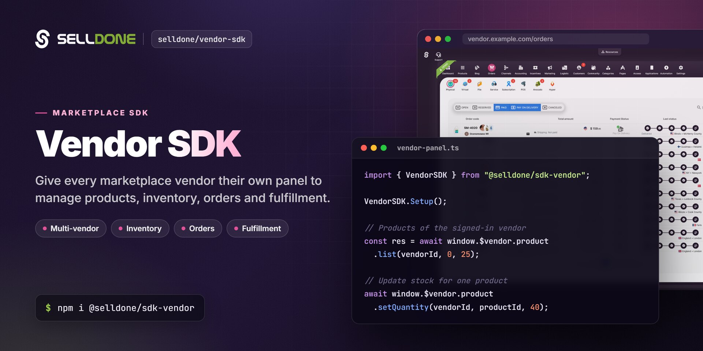

<p align="center">
  
</p>

<p align="center">
  <a href="https://www.npmjs.com/package/@selldone/sdk-vendor"></a>
  <a href="https://www.npmjs.com/package/@selldone/sdk-vendor"></a>
  <a href="LICENSE.md"></a>
  <a href="https://github.com/selldone/vendor-sdk/wiki"></a>
  <a href="https://selldone.com"></a>
</p>

<p align="center">
  <b>The API client for marketplace vendor panels: let each vendor of a Selldone multi-vendor marketplace manage products, inventory, orders and fulfillment.</b><br>
  <a href="https://github.com/selldone/vendor-sdk/wiki">Documentation</a> ·
  <a href="#quick-start">Quick start</a> ·
  <a href="https://github.com/selldone">Ecosystem</a> ·
  <a href="https://selldone.com">Selldone.com</a> ·
  <a href="https://github.com/selldone/vendor-sdk/issues">Report an issue</a>
</p>

<p align="center">
  <a href="https://github.com/selldone/storefront">Storefront</a> ·
  <a href="https://github.com/selldone/pagebuilder">Page Builder</a> ·
  <a href="https://github.com/selldone/components">Components</a> ·
  <a href="https://github.com/selldone/storefront-sdk">Storefront SDK</a> ·
  <a href="https://github.com/selldone/backoffice-sdk">Backoffice SDK</a> ·
  <b>Vendor SDK</b> ·
  <a href="https://github.com/selldone/community-sdk">Community SDK</a> ·
  <a href="https://github.com/selldone/core">Core</a> ·
  <a href="https://github.com/selldone/cli">CLI</a> ·
  <a href="https://github.com/selldone/translate">Translate</a>
</p>

## Overview

**Vendor SDK** (`@selldone/sdk-vendor`) is the TypeScript client for the vendor side of a
[Selldone®](https://selldone.com) **multi-vendor marketplace**. In a marketplace shop, the owner runs the store and
many independent vendors sell through it. Each vendor works in its own **vendor panel**, where it oversees its
products, manages inventory, receives orders and handles fulfillment directly.

The marketplace owner manages vendors from the Selldone dashboard or with the
[Backoffice SDK](https://github.com/selldone/backoffice-sdk). The Vendor SDK covers the other half: every call is
scoped to one vendor (`/vendors/{vendor_id}/...`), so a vendor only sees and changes its own data.

The SDK provides `window.VAPI`, a catalog of vendor API URL builders, and `window.$vendor`, typed request wrappers for
pages, products, categories, articles and logistic profiles. Use it to build a branded vendor panel, or to embed
vendor tools in an existing app.

## Key features

- **One setup call** — `VendorSDK.Setup()` registers `window.VAPI` and `window.$vendor` (`page`, `product`, `category`, `article`, `logistic`).
- **Vendor-scoped product management** — list products, read full product details, set stock, move products between categories, tag products, and remove or restore variants.
- **Bulk import** — send a spreadsheet-style dataset to the vendor's product importer, then inspect and retry the product and image queues.
- **Full vendor API catalog** — `window.VAPI` has URL builders for orders, payments, inventory offers, shipping, warehouse, members, listings and more.
- **Automatic authentication** — reads the vendor's access token from `window.SelldoneUser` or the `vendor_access_token` cookie and sends it as a bearer token.
- **Same API shape as the Backoffice SDK** — the vendor methods mirror `window.$backoffice` with `vendor_id` in place of `shop_id`, so shared UI can switch between them.
- **Caching and cancellation** — every namespace supports `.optimize()`, `.force()`, `.cancellation()` and `.cache()` from Selldone Core.

## Quick start

**1. Install**

```bash
npm install @selldone/sdk-vendor
```

```bash
yarn add @selldone/sdk-vendor
```

**2. Configure and authenticate**

The SDK reads its endpoints from `<meta>` tags. `selldone-vapi` is the base URL of the vendor API:

```html
<meta name="service-url" content="https://selldone.com">
<meta name="selldone-vapi" content="VENDOR_API_BASE_URL">
```

Provide the vendor's access token before setup. The SDK sends it as `Authorization: Bearer …` and stores it in the
`vendor_access_token` cookie:

```js
window.SelldoneUser = { access_token: ACCESS_TOKEN, expires_in: EXPIRES_IN };
```

**3. Initialize and make your first call**

```js
import { SelldoneCore } from "@selldone/core-js";
import { VendorSDK } from "@selldone/sdk-vendor";

SelldoneCore.Setup();

// ━━━ Vendor SDK (vapi) ━━━
VendorSDK.Setup(); // Registers window.VAPI and window.$vendor

// Products of the signed-in vendor
const { products, total } = await window.$vendor.product.list(VENDOR_ID, 0, 25, { with_total: true });

// Update stock for one product
await window.$vendor.product.setQuantity(VENDOR_ID, products[0].id, 40);
```

## Usage

### The `window.$vendor` namespaces

| Namespace | Methods | Vendor API routes |
|---|---|---|
| `product` | `list()`, `getInfo()`, `setQuantity()`, `changeCategory()` | `/vendors/{vendor_id}/products/...` |
| `product.importer` | `send()`, `info()`, `que.products()`, `que.removeProduct()`, `que.images()`, `que.removeImage()`, `que.syncImage()` | `/vendors/{vendor_id}/import/...`, `/vendors/{vendor_id}/importing` |
| `product.tags` | `set()` | `POST /vendors/{vendor_id}/products/{product_id}/tags` |
| `product.variants` | `remove()`, `restore()` | `/vendors/{vendor_id}/products/{product_id}/variants/{variant_id}/...` |
| `product.vendor` | `list()` | `GET /vendors/{vendor_id}/products/{product_id}/vendors` |
| `category` | `list()` | `GET /vendors/{vendor_id}/categories` |
| `page` | `getPageAugment()` | `GET /vendors/{vendor_id}/pages/{page_id}/augment` |
| `article` | `tags.getTags()`, `tags.setArticleTags()` | `/vendors/{vendor_id}/articles/tags` |
| `logistic` | `profile.list()` | `GET /vendors/{vendor_id}/logistic-profiles` |

List methods take `(vendor_id, offset, limit, options?)`. Full signatures and response fields are on the
[JavaScript SDK](https://github.com/selldone/vendor-sdk/wiki/JavaScript-SDK) wiki page.

### Calling the rest of the vendor API

For operations without a wrapper (orders, payments, inventory offers, shipping and more), build the URL with
`window.VAPI` and call it with `window.axios`:

```js
// List the vendor's members
const { data } = await window.axios.get(window.VAPI.GET_MY_VENDOR_MEMBERS(VENDOR_ID));
```

See [Vendor API URL Builders](https://github.com/selldone/vendor-sdk/wiki/Vendor-API-URL-Builders) for the full
catalog.

### Owner side vs vendor side

| Task | Marketplace owner (Backoffice API) | Vendor (this SDK) |
|---|---|---|
| List vendors | `GET /shops/{shop_id}/vendors` | `GET /vendors` (vendors the user belongs to) |
| Assign a vendor to a product | `POST /shops/{shop_id}/products/{product_id}/vendors` | Not available |
| Change an offer's price or stock | `PUT /shops/{shop_id}/products/{product_id}/vendors/{vendor_product_id}` | `PUT /vendors/{vendor_id}/inventory/{vendor_product_id}` |
| Manage own products | `/shops/{shop_id}/products/...` | `/vendors/{vendor_id}/products/...` |

Owner-side endpoints are documented in the Backoffice SDK wiki:
[Get Vendors List](https://github.com/selldone/backoffice-sdk/wiki/Get-Vendors-List),
[Vendor Products List](https://github.com/selldone/backoffice-sdk/wiki/Vendor-Products-List),
[Vendor Product Add](https://github.com/selldone/backoffice-sdk/wiki/Vendor-Product-Add),
[Vendor Product Update](https://github.com/selldone/backoffice-sdk/wiki/Vendor-Product-Update) and
[Vendor Product Delete](https://github.com/selldone/backoffice-sdk/wiki/Vendor-Product-Delete).

## Documentation

| Page | What you'll learn |
|---|---|
| [Getting Started](https://github.com/selldone/vendor-sdk/wiki/Getting-Started) | Install, configure, authenticate and make your first call |
| [Vendor Panels and Marketplaces](https://github.com/selldone/vendor-sdk/wiki/Vendor-Panels-and-Marketplaces) | How vendors, offers and the owner dashboard fit together |
| [JavaScript SDK](https://github.com/selldone/vendor-sdk/wiki/JavaScript-SDK) | Every `window.$vendor` method with parameters and responses |
| [Products and Inventory](https://github.com/selldone/vendor-sdk/wiki/Products-and-Inventory) | Recipes for listing, stock updates, categories, variants and bulk import |
| [Vendor API URL Builders](https://github.com/selldone/vendor-sdk/wiki/Vendor-API-URL-Builders) | The `window.VAPI` catalog grouped by area |
| [FAQ](https://github.com/selldone/vendor-sdk/wiki/FAQ) | Common questions and troubleshooting |

## How it fits in the ecosystem

The Vendor SDK sits next to the [Backoffice SDK](https://github.com/selldone/backoffice-sdk): the backoffice serves
the marketplace owner, the vendor SDK serves each vendor. Both build on [Selldone Core](https://github.com/selldone/core),
and the backoffice widgets in [Components](https://github.com/selldone/components) switch to `window.$vendor` when they
run inside a vendor panel.

<a href="https://github.com/selldone#ecosystem"></a>

| Related project | Why you'd use it |
|---|---|
| [Backoffice SDK](https://github.com/selldone/backoffice-sdk) | Manage vendors and vendor offers as the marketplace owner |
| [Core](https://github.com/selldone/core) | Shared models, enums and the HTTP base class (required) |
| [Components](https://github.com/selldone/components) | Vue 3 backoffice widgets that work in vendor-panel mode |
| [Storefront](https://github.com/selldone/storefront) | The customer-facing storefront where vendor offers are sold |
| [Storefront SDK](https://github.com/selldone/storefront-sdk) | Build a custom marketplace storefront |

## Contributing

Contributions are welcome. Please read the organization
[contributing guide](https://github.com/selldone/.github/blob/main/CONTRIBUTING.md) and
[code of conduct](https://github.com/selldone/.github/blob/main/CODE_OF_CONDUCT.md). To develop this package together
with a consuming project, use `yarn link` as described in [DEVELOPMENT.md](DEVELOPMENT.md).

New vendor endpoints belong in `apis/VAPI.ts` as URL builders; typed wrappers live in the folder of their namespace
(for example `product/requests/`).

## Security

Please do not report vulnerabilities in public issues. Email **security@selldone.com**. See the organization
[security policy](https://github.com/selldone/.github/blob/main/SECURITY.md).

## License

See [LICENSE.md](LICENSE.md).

<details>
<summary><b>Selldone Ecosystem License Agreement</b></summary>

1. **Scope of License**: This license is granted exclusively for the use of the enclosed code (hereinafter referred to as "the Code") within the Selldone ecosystem. The licensee is authorized to use the Code solely in conjunction with services and applications that are part of, or directly related to, the Selldone ecosystem.

2. **Commercial Use Restriction**: The licensee is strictly prohibited from using the Code for any commercial purposes outside the Selldone ecosystem. Commercial utilization is permissible only when it is within the Selldone ecosystem and in accordance with the terms of this agreement.

3. **Permission for Free Use**: The Code may be used for non-commercial, free services, provided that explicit credit is given to Selldone. This credit must include the name "Selldone" prominently displayed on the user interface of the relevant service or application, along with a hyperlink to [selldone.com](https://selldone.com).

4. **No Redistribution**: The licensee may not redistribute the Code, in whole or in part, to any third party outside the Selldone ecosystem, unless expressly authorized by Selldone.

5. **No Modification for Redistribution**: While modifications to the Code for personal or internal use within the Selldone ecosystem are allowed, the licensee may not modify the Code for the purpose of redistribution outside the Selldone ecosystem.

6. **Termination**: Failure to comply with the terms of this agreement will result in the immediate termination of the license and may subject the licensee to legal action.

7. **Disclaimer of Warranty**: The Code is provided "as is" without any warranties of any kind, either expressed or implied, including but not limited to implied warranties of merchantability or fitness for a particular purpose.

8. **Limitation of Liability**: In no event shall Selldone be liable for any damages arising out of the use or inability to use the Code.

9. **Jurisdiction and Disputes**: This agreement shall be governed by the laws of the jurisdiction where Selldone is established. Any disputes arising from this agreement shall be resolved in the courts of that jurisdiction.

By using the Code, the licensee acknowledges that they have read, understood, and agreed to the terms of this license.

</details>

---

<p align="center"><sub>Part of the <a href="https://github.com/selldone">Selldone® Business OS</a> open-source ecosystem · <a href="https://selldone.com">selldone.com</a></sub></p>
